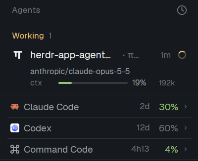
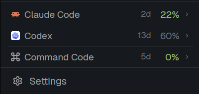
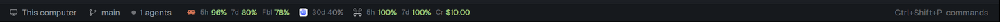

# herdr-app-agent-quota

A [Herdr desktop app](https://github.com/herdrdev/herdr-app) **mod** that shows each agent's active
model and context use directly under the agent in the Agents list, and your subscriptions' quota
(5h / 7d / Fable weekly / credits) in a pinned footer and, optionally, the status bar.



*An agent with its model and context gauge (`ctx`), and the subscriptions footer below it. The empty space
between them is cropped.*

- **Follows the active model.** Under a Claude Code, omp, Command Code or Codex agent: its model and how
  full its context is. An agent on an API or gateway model (a cluster, LM Studio, `glm-*`, `kimi-*`, ...)
  also says `no subscription quota`, because no subscription's limits apply to it. The limits themselves
  live in the footer and status bar, not under each agent; only an agent whose model the mod can't read
  (another program with a subscription) still shows that subscription's limits under its row.
- **Live numbers** come from [`omp usage --json`](https://github.com/can1357/oh-my-pi): Anthropic 5h, 7d
  and the separate 7d **Fable** limit, and Command Code 5h, 7d and credit balance.
- Limit gauges turn red under 15% left and yellow under 40%; a window whose reset has passed shows `n/a`.
- **Why an agent is blocked:** under a blocked agent's row (including sub-agents) the mod shows what it
  is waiting for, e.g. `Permission · Run: rm -rf build/ ?` or `Question · Which database?`, in the blocked
  colour. It uses the agent's own status report (OSC 7501 `kind` and `msg`), never the screen, so an agent
  that doesn't send them shows only `Waiting for you`.
- **Context window per agent:** a `ctx` gauge under each omp, Claude Code, Command Code and Codex agent
  shows how full its context is (**% used**, plus the token count), for subscription and API models alike.
  Sizes come from `omp models --json` (Command Code models as `commandcode/<id>`); Codex reports its own
  window, and its percent is worked out as Codex's footer does (`Context N% used`, leaving out a 12k-token
  baseline). For a Claude Code gateway model (not `claude-*`) the percent Claude Code itself measured is
  used if the plugin recorded it, otherwise only the token count is shown.
- **Session cost per agent**, at the right of the model line: what the agent's session has cost so far.
  omp sums each request's cost, including its own side requests (session title, captions); Claude Code's
  own running total is used; Command Code sums what it charges. On a model a subscription can cover
  (Anthropic, Command Code, Codex) it's marked as an estimate, `≈$9.79`, because omp and Claude Code price
  every request at API list prices even when your plan pays for it. A free or local model ($0) shows
  nothing, and so does Codex, which records no cost. Agents on another machine show no cost (only part of
  their transcript is read).
- **Pinned subscriptions footer** (bottom of the Agents panel), styled after Over9k's usage block: one row
  per subscription (Claude Code, Codex, Command Code) with its fullest limit's **% used** and reset time,
  whether or not an agent is running; subscriptions with a running agent come first. Click a row to open
  every limit (`5h`, `7d`, `Fable`, `Cr` credits) as a bar; click a limit to pin it as the row's headline
  (click again to unpin). Red from 80% used, yellow from 50%. Hover a row for reset times. The footer is
  capped at 180 px and scrolls if there are more rows than fit.

  

- **Status bar summary** (optional, bottom of the window): next to *This computer*, the branch and the
  agent count, a compact strip with each selected subscription's icon and its limits as **% remaining**
  (`5h 96%  7d 80%  Fbl 78%`, credits as `Cr $10.00`). Red under 15% left, yellow under 40%, `n/a` once a
  window has reset. Hover for reset times. Click the strip to choose which subscriptions are shown (all
  by default). It is independent of the Agents panel footer.

  

- **Adding a subscription** is data, not UI code: add its provider to `LABELS` in `reports.js` (live data
  from `omp usage --json`; skip for cache-only providers) and one entry to `SUBSCRIPTIONS` in
  `subscriptions.js` (name, icon, which card to use). It then appears in the footer by itself.

| Active model | Under the agent | Counts toward (footer) |
|---|---|---|
| Claude Code, `claude-*` | model, `ctx` | Claude Code (Anthropic 5h, 7d, Fable, live) |
| Claude Code, anything else | model, `ctx`, `no subscription quota` | nothing |
| omp, `anthropic/...` | model, `ctx` | Claude Code (live) |
| omp, `commandcode/...`; the `commandcode` CLI (Windows, needs the hook below) | model, `ctx` | Command Code (5h, 7d, credits `Cr`, live) |
| omp, `openai-codex/...` | model, `ctx` | Codex, from the optional plugin cache (see below) |
| Codex | model, `ctx` | Codex, from the optional plugin cache |
| omp, any other provider | model, `ctx`, `no subscription quota` | nothing |
| model not known yet, or a folder outside your home | nothing | |

## Requirements

- Herdr desktop app (built against mod API / `agents` mod **v0.1.16**).
- `omp` on your `PATH` for live Anthropic / Command Code limits. Without it those rows stay empty.
- Optional: the [herdr-agent-usage](https://github.com/levi-qiao/herdr-agent-usage) plugin, whose cache
  is the only source for Codex (and other providers it supports). That cache only updates while a Herdr
  TUI session is running, so those gauges turn gray after 30 minutes.

## Install

```sh
git clone https://github.com/ivanvykopal/herdr-app-agent-quota
cd herdr-app-agent-quota
./install.sh            # macOS / Linux
./install.ps1           # Windows (PowerShell)
```

This copies `mods/agents-quota/` to `~/.config/herdr-app/mods/` (or `$HERDR_APP_HOME`) and runs
`herdr-app check`. Or copy that folder by hand.

On Windows, `install.ps1` also installs the **Command Code status hook**
(`integrations/commandcode/install.ps1`, which can also be run alone). Command Code doesn't report its status
to Herdr itself, so without the hook a running `commandcode` is just a shell and never appears under
Agents. The installer copies `herdr-commandcode-state.ps1` to `~/.commandcode/hooks/` and adds
`SessionStart`, `PreToolUse`, `PostToolUse` and `Stop` hooks to `~/.commandcode/settings.json`. It keeps
your other settings, backs the file up as `settings.json.bak`, and replaces its own earlier entries.
Restart running `commandcode` sessions afterwards. Command Code has no prompt or permission hook, so its
row shows *working* from the first tool call (not while it only writes text) and never shows *blocked*.
Status changes show up within a few milliseconds. The row is removed when Command Code exits. Headless runs
(`commandcode -p`) are ignored. Not available on macOS / Linux yet.

The mod **replaces the Agents panel**, so a layout has to use it. Herdr's shipped layouts are read-only,
so clone one and point its agents block at the mod:

```sh
herdr-app do layout.clone '{"name":"main","as":"main-quota"}'
```

then in `~/.config/herdr-app/layouts/main-quota.json` set the agents block to
`"content": { "mod": "agents-quota" }`. `ctrl-shift-l` switches layouts.

To also get the subscription limits in the window's bottom bar, point the `status` block at the same mod
(it replaces Herdr's `workspace-status` and keeps everything it showed):

```json
{ "id": "status", "type": "block", "content": { "mod": "agents-quota", "props": { "status": true } }, "size": { "px": 28 } }
```

## What it runs and reads (review before installing)

Mods are trusted code. This one:

- runs `omp usage --json` once a minute (omp contacts the Anthropic / Command Code usage endpoints
  itself, and caches for ~5 min);
- runs `powershell` (Windows) or `sh` + `ls` (macOS / Linux) every ~30 s per Claude Code / omp / Command
  Code / Codex agent to find the newest session transcripts by file time;
- reads session transcripts under `~/.omp/agent/sessions/`, `~/.claude/projects/`,
  `~/.commandcode/projects/` and `~/.codex/sessions/` (the 24 newest uncompressed rollouts; only the folder,
  model name, title and token counts are used), and, if present, the herdr-agent-usage cache under
  `~/.../herdr/plugins/herdr-agent-usage/`;
- for agents on another machine (a Herdr SSH machine), does the same there through the core (`exec` with
  `on`): `sh` to read the home folder, list transcripts with `ls -t` / `stat`, read the first 4 KiB and last
  1 MB of the newest ones with `head` / `tail`, and `omp usage --json` once a minute per machine; nothing is
  copied off the machine except those few lines' worth of model, title and token numbers;
- makes no network calls of its own and writes no files; it only remembers your footer and status-bar
  choices (open rows, pinned limits, selected subscriptions) in the app's own shared state.

The Command Code hook (Windows) runs `powershell` once per Command Code session: it lists processes
(`Win32_Process`) to find the Command Code process and starts a hidden `powershell` watcher that stays
attached to that console until Command Code exits, writing one OSC 7501 status line per change. Tool calls
and turn ends run a one-line `cmd` command that writes the new state to
`%TEMP%\herdr-commandcode-<terminal>.state`; the watcher keeps its pid in `...<terminal>.watch`. Both files are
deleted when the session ends. It makes no network calls.

## Limits

- Quota is per provider, not per session: two Claude Code agents show the same numbers.
- Two omp (or two Claude Code) agents in one folder are told apart, each with its own model and context:
  first by the session title appearing in the terminal title, otherwise by timing (a working agent is
  writing now; an idle one wrote its last message when it went idle). A transcript older than the agent's
  terminal is never assigned. If an agent has no transcript yet (omp writes it on the first message), it
  shows no model rather than a neighbour's. Matching by timing is a best effort when several agents sit
  idle in one folder. Model changes show up within ~40 s.
- Command Code and Codex agents are matched by timing only (both keep their session titles outside the
  transcript). Headless runs (`commandcode -p`, `codex exec`) in the same folder write transcripts too, so one
  that ran within seconds of an idle agent's last turn can show its model and context instead, until that
  agent's next turn. Command Code and Codex agents are read on this computer only. A Codex session idle for
  so long that 24 newer rollouts exist elsewhere shows no model until its next turn.
- **Remote agents** (omp or Claude Code on another Herdr machine) show their model, context and blocked
  reason like local ones. Their quota is **that machine's own** `omp usage` (its logins), never this
  computer's: if omp isn't installed or logged in there, the row says `quota not read on <machine>`. The
  pinned footer stays local. The remote machine is assumed to be Unix (`sh`, `ls`, `stat`, `head`, `tail`),
  and its clock is used for matching transcripts to agents. Each refresh costs a few SSH round trips.
- It is a modified copy of Herdr's `agents` mod; Herdr never updates it. After an app update, re-clone
  `agents` and re-apply the patch (see `RECIPE.md`, *Built from*).

## License

Apache-2.0, see [LICENSE](LICENSE) and [NOTICE](NOTICE).
