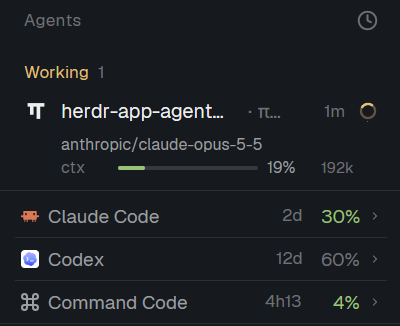

# Agent quota

The Agents list in the Herdr desktop app, with each agent's **active model** and **context use** right under
the agent's row, and the subscriptions' limits in a pinned footer (and optionally the status bar). A Claude
Code agent on `claude-sonnet-5-5` shows its model and `ctx`; an omp agent on `lm-studio/glm-5.3` shows its
model, `ctx` and `no subscription quota`.

## What you see

The shipped Agents panel (header "Agents", sort button, groups such as Working / Idle / Needs you, one
30px row per agent with icon, name, status). Under a row, when something is known, a block indented 33px
(to line up under the name), 8px right padding, 4px bottom padding, 1px between lines, each line 15px tall:

1. **Model line**, always when a model is known: the model id (`anthropic/claude-sonnet-5-5`,
   `lm-studio/glm-5.3`) in 10.5px `muted`, truncated; for a model with no subscription, a second piece
   `· no subscription quota` in 10px `dim`; at the right (after a flexible gap), the session cost in 10.5px
   `muted`: `$1.23`, `$123`, `<$0.01`, prefixed `≈` on a subscription provider (`anthropic`, `commandcode`,
   `openai-codex`: list price for usage the plan may cover). No cost when it's $0 or unknown.
2. **Context line**, for any model with a known size of last request (subscription or not): label `ctx`,
   a gauge filled to the context window **used** (always used, not remaining, like the agents' own
   footers), percent, and a tail with the token count (`353k`, `1.2M`). Red past 85% used, yellow past
   60%. When only a token count is known (no window), the line reads `<n> tokens` in `muted`.
3. **One gauge line per limit**, only where nothing else shows them: an agent whose model the mod can't
   read (a program without a transcript reader, but with a subscription) or one on another machine: a
   32px label (`5h`, `7d`, `Fable`, `30d`, `Cr`) in 10.5px `dim`; a 3px-tall rounded track (`raised`)
   filled to the shown percent; a 30px percent in 10.5px `muted`; a 38px tail in 10px `dim` (time to reset
   like `1h08`, `2d`; for `Cr` the dollars left like `$10.00`). omp, Claude Code, Command Code and Codex
   agents on this computer never show limit lines: the footer and status bar already show them.
4. Nothing at all when the model isn't known yet or the agent has no folder under the home folder.
5. **Pinned footer**, below the agent list and above the sidebar footer, hidden in the narrow rail: a 1px
   `border` top line, 16px side padding, 6px vertical, 2px between lines. One 16px line per subscription
   that has data: a 12px provider icon (single-colour glyphs tinted `muted`), then `label value` pills 8px
   apart, label 10px `dim`, value 10.5px semibold coloured like the gauges (`dim` when the reading is older
   than 30 min or reset). Claude Code: `5h 87%  7d 80%  Fbl 78%` (Fable shortened to `Fbl`); Codex:
   `30d 40%`; Command Code: `5h 100%  7d 100%  Cr $10.00` (credits show the dollars left, not a percent).
   Hover shows a tooltip with the provider name and reset times. Subscriptions with a running agent are
   listed first. With more than 3, only 3 show plus a 14px `> +N more` row (10px `dim`, chevron);
   clicking it opens the list in place, growing to show every row with no scrolling and no clipping, and
   the row becomes `v less`.
6. **Blocked reason**, directly under the row (and under a blocked sub-agent's row, indented 64px) of an
   agent whose own status report is `blocked`: 10.5px text in the `blocked` colour, up to two lines
   (clipped, never scrolling), full text on hover. It reads `<Kind> · <message>`, e.g.
   `Permission · Run: rm -rf build/ ? Allow this command` or `Question · Which database should I use?`;
   kinds `permission`, `question`, `auth` (shown `Sign-in`); with neither it says `Waiting for you`.
   Nothing is shown for an agent that isn't blocked. It sits above the model / context / quota lines.

Fill colour follows what is left, whichever number is shown: `ansi1` (red) under 15% left, `ansi3`
(yellow) under 40%, `ansi2` (green) otherwise, `dim` when the reading is older than 30 minutes.

## How it behaves

- Agent statuses (working, blocked, done, idle) look and act exactly as in the shipped `agents` mod; the
  quota block follows its row, and folding an agent with sub-agents keeps the block, hides the sub-rows.
- A limit whose reset time has passed shows a `dim` empty track, `n/a` and `reset` instead of a number.
- The percentage is remaining quota by default; the herdr-agent-usage plugin's `quota-percent` file set
  to `used` flips it.
- No clicks or keys of its own. The narrow rail (sidebar < 160px) shows no quota.
- Data updates: the mod re-reads every 10 s; `omp usage --json` at most once a minute; each agent's
  model at most every 30 s.

## Built from

A clone of the shipped `agents` mod (`herdr-app do mod.clone '{"name":"agents","as":"agents-quota"}'`,
version 0.1.16) with `mod.json` `{"place":"none","title":"Agents"}`, plus eleven modules:

- `quota.js`: `loadQuota(prev, targets)` (targets: `{ kind, cwd, address, status }` per omp / Claude Code / Command Code
  agent) returns `{ live, cache, contexts, used, liveAt, windows, windowsAt, fileCache, models }` (`models`
  is keyed by agent address, entries `{ model, tokens, sessionId, status, at }`); `agentQuota(q, agent)`
  returns `{ model, card, note, context, limits }` or null (`limits`: draw the card's lines under the row);
  `quotaBlock(t, info, used)` draws it; `modelKind(agent)`
  is `"omp"`, `"claude"`, `"commandcode"` (program key `command-code`), `"codex"` or null. Per folder group it lists
  the newest 8 transcripts (`*.checkpoints.jsonl` excluded) with their write times
  (`powershell Get-ChildItem` on Windows, `ls -t` + `stat` elsewhere), reads each once per (file, mtime),
  asks `hc get --json <address>` for the agent's `created_ms`, `status_ms` and title, then calls
  `assignTranscripts`. The model catalog comes from `omp models --json` every 10 min.
- `assign.js`: `assignTranscripts(agents, candidates, now)` -> Map(agent id -> candidate | null), with agents
  `{ id, working, statusMs, createdMs, paneTitle }` and candidates `{ file, mtimeMs, title }`. Order: a
  transcript last written before the terminal started is ineligible; a title match (letters and digits of the
  session title contained in the terminal title, at least 6 characters) wins; then closest time (a working
  agent against now, an idle one against `status_ms`), each transcript used once. Unmatched agents get null.
- `commandcode-session.js`: `commandcodeProjectDir(names, cwd)` picks the `~/.commandcode/projects` entry
  whose letters and digits equal the cwd's (Command Code's slug splits camelCase: `AppData` -> `app-data`, so
  don't rebuild it); `lastCommandcodeModel(text)` is the last top-level `"model"` (assistant messages and
  `model_change` records, e.g. `recursive/flint-v1.0:free`); `commandcodeLastTokens(text)` is the last
  assistant line's `usage.inputTokens` (cache reads included; what Command Code's compaction measures).
  Window: catalog key `commandcode/<model>`. Every Command Code model gets the Command Code card. Local only.
- `codex-session.js`: Codex files are `~/.codex/sessions/YYYY/MM/DD/rollout-*.jsonl` (by date; old ones
  become `.jsonl.zst`, not read), so the spec lists the 24 newest `*.jsonl` recursively and keeps those whose
  first line (`session_meta`) `payload.cwd` is the agent's folder (`sameFolder`: slashes, trailing slash,
  case). `codexState(text)`: model from the last `turn_context` `payload.model`; tokens from the last
  `token_count` `payload.info.last_token_usage.total_tokens`; percent as Codex's footer computes it,
  `(tokens - 12000) / (model_context_window - 12000)`, passed as the context percent (no catalog).
  `codexQuota(text)`: the Codex card `{ provider: "codex", fetched: line timestamp, windows }` from the last
  `token_count` with `payload.rate_limits` (`limit_id` `codex` or absent; `null` for API-key sessions is
  skipped); `primary` / `secondary` become rows labelled by `window_minutes` (300 -> `5h`, 10080 -> `7d`,
  43200 -> `30d`, as the plugin names `monthly`). `codexLiveQuota(stdout, now)`: the same card from
  `codex app-server`'s JSON-RPC answer id 2 (`account/rateLimits/read`: `rateLimitsByLimitId.codex`, camelCase
  `usedPercent` / `windowDurationMins` / `resetsAt`), `fetched` = now. `loadQuota` asks the app server once a
  minute (`exec` has no stdin: Windows runs a PowerShell `Process` with redirected stdin over `cmd /c codex
  app-server`, Unix a `sh` pipe that holds stdin open until the answer lands in a `mktemp` file); on failure
  it reads the 8 newest rollouts (through the transcript cache). The newer of the new and the previous
  reading is kept in `q.codex`. Card (footer and agent rows): `codexCard(q)` in `subscriptions.js`, whichever
  of `q.codex` and the plugin's `codex` cache has the later `fetched`; no `no subscription quota` note
  without either. Local only.
- `cost.js`, over the WHOLE local transcript (remote reads are head + tail, so no cost): `ompCost(text)`
  sums every `"cost":{...,"total":n}` (assistant messages and omp's `model_usage` side requests: title,
  captions); `claudeCost(text)` is the last `{"type":"cost-state"}` record's `totalCostUSD` (null when
  `hasUnknownModelCost`); `commandcodeCost(text)` sums `"costUsd"`; `fmtCost(n, estimate)`. Codex: none.
- `context.js`: `ompLastTokens(text)` (assistant `contextSnapshot.promptTokens`, else usage totals),
  `claudeLastTokens(text)` (last assistant `usage`: input + cache read + cache creation tokens),
  `parseModelCatalog(json)` (`provider/id` -> `contextWindow`), `catalogWindow(map, model)` (also tries
  dated Claude ids), `contextOf({ tokens, window, cachedPct })` -> `{ pct, tokens }`, `fmtTokens(n)`.
  Window: omp models from the catalog by `provider/id`; Claude Code `claude-*` models from the catalog's
  `anthropic/<id>`; any other Claude Code model has no trusted window, so only the percent the plugin
  measured per session (`session_contexts` in `claude-statusline.json`, keyed by transcript name) is used.
- `blocked.js`: `blockedReason(report)` -> `{ kind, msg }` or null (null unless `report.state` is
  `blocked`) and `reasonText(reason)`. `report` is the agent's own OSC 7501 record (`state=blocked:kind=
  permission|question|auth:msg=<base64>`), read from `terminals()[i].report` (or its `status` object).
  Control and escape sequences are stripped and the text capped at 160 characters. The screen is never
  parsed: herdr-core doesn't guess state from screen text, and neither does this.
- `omp-session.js` / `claude-session.js` also export `ompTitle(head)` (first line `{"type":"title"}` of an
  omp transcript) and `claudeTitle(text)` (last `ai-title` record).
- `reports.js`: `parseReports(json)` turns `omp usage --json` into one card per provider. The fill uses
  each limit's `usedFraction` (Anthropic reports percent, Command Code an "unknown" unit). Row labels:
  anthropic `5h`, `7d`, `7d:fable` -> `Fable`; commandcode `5h`, `7d`, `credits` -> `Cr` (+ dollars left).
- `subscriptions.js`: `SUBSCRIPTIONS`, the registry of pinned subscriptions (`id`, `name`, `icon`, `tint`,
  `providers`, `card(q)`), `availableSubscriptions(q)` (those with data) and `layoutSubscriptions(items,
  active, open, limit)` (active first, then at most `limit` unless open) -> `{ shown, hidden, collapsible }`.
  To add one: an entry here, plus its provider in `reports.js` `LABELS` when live data exists.
- `omp-session.js`: omp transcripts live in `~/.omp/agent/sessions/<cwd minus home, separators to "-">/`
  (home itself is `-`). `activeModel(text)` scans lines from the end and returns the first of an assistant
  message (`message.provider` + `message.model` -> `provider/model`) or a `model_change` entry (`model`).
- `claude-session.js`: transcripts in `~/.claude/projects/<cwd with every non-alphanumeric -> "-">/`;
  `lastClaudeModel(text)` is the last `"model":"..."` that isn't `<synthetic>`; `claudeProvider(model)` is
  `anthropic` only for ids starting `claude-`.
- Patch to `main.js`: import from `./quota.js`; in `init`, `this.quota` plus a `cx.timer.every(10000)` that
  builds `targets` from `agents()` and `panes()` (cwd by `a.pane`) and calls `loadQuota`; in `render`,
  `cwdOf = new Map(panes().map(p => [p.pane, p.cwd]))`; in `withKids`, `quotaBlock(t, agentQuota(...),
  this.quota.used)` inserted after the row (not when collapsed).

Which quota an active model gets: `claude-*` (Claude Code) or `anthropic/*` (omp) -> live Anthropic card;
`commandcode/*` (omp) or the `commandcode` CLI -> live Command Code card; `openai-codex/*` -> Codex, live from
`codex app-server`, else its rollouts or the herdr-agent-usage plugin cache (newest wins); everything else ->
model name + note.

Reads and runs (tell the person before installing): `exec("omp", ["usage","--json"])`;
`exec("powershell", ["-NoProfile","-Command", "(Get-ChildItem -LiteralPath '<dir>' -Filter *.jsonl | Sort-Object
LastWriteTime -Descending | Select-Object -First 1).Name"])` on Windows, `sh -c 'ls -t "$1"/*.jsonl | head -1'`
elsewhere; `fs/promises` `readdir`/`readFile` of transcripts and of
`<home>/AppData/Local/herdr/plugins/herdr-agent-usage/` (Linux/macOS equivalents are tried);
`readTextFile` of that folder's JSON and `quota-percent`. No network of its own, no writes. Herdr API used:
`agents`, `panes`, `theme`, `home`, `exec`, `readTextFile`, `cx.timer.every`, `cx.spawn`.

## Watch out

- Agents in one folder are told apart by `assign.js`, not by "newest file": an older session can be the active
  one and two agents can share a folder. Names alone were wrong; file times need the OS (`exec`).
- A remote agent (address `machine/t7`) is read on its machine: `exec(..., { on: machine })` for the home
  folder (`printf %s "$HOME"`, kept after the first success), the transcript list (`ls -t` + `stat`),
  and `head -c 4096; tail -c 1000000` of each candidate (`readTextFile` stops at 1 MiB). `omp usage --json`
  runs there with `~/.local/bin` added to PATH (non-interactive shells lack it) and fills only that
  machine's agents. Paths outside the home folder use omp's `--<path>--` folder form, remote or local.
  A remote agent never falls back to this computer's cache or numbers. Reloads can't overlap (`reloading`),
  because a remote call may take seconds.
- omp assistant messages carry the real provider and model even when no `model_change` was ever written
  (a model from config), so don't rely on `model_change` alone.
- Context is per agent, from the last request in that agent's own transcript. Check it against the agent's
  own footer: an omp pane footer reads like `35.3%/1M`.
- The Claude and Codex numbers don't depend on which agent row it is; they are per provider.
- The blocked reason is only as good as what the agent reports: an agent that sends `state=blocked` with no
  `msg` or `kind` shows `Waiting for you`. Test with a throwaway terminal that prints
  `ESC ] 7501 ; state=blocked:kind=permission:app=test:msg=<base64> ESC \` (kill and `hc rm` it afterwards).
- `readTextFile` caps at 1 MiB; transcripts are read with `fs.readFile` and only the last 1,000,000
  characters are scanned.
- The mod replaces the whole Agents panel; a layout must reference `agents-quota`. Shipped layouts are
  read-only, so clone one first. The clone is never updated by Herdr.
- `herdr-app check` really runs `omp usage` (a warning says so).
- Dash-prefixed folder names (`-Desktop-...`) need `./` or `--` in shell commands when debugging.
- Command Code never sends OSC 7501, so Herdr doesn't list it as an agent without
  `integrations/commandcode/` (Windows). Its hooks (`~/.commandcode/settings.json`, all `async`) run with
  piped stdio and `windowsHide`, so their output never reaches the terminal. Design: `SessionStart` runs
  PowerShell once: it finds the nearest `node.exe` ancestor (Command Code), skips headless runs
  (`-p`/`--print`, which may share another agent's terminal) and starts a hidden watcher. The watcher
  `AttachConsole`s to Command Code and writes to `CONOUT$` (`CreateFileW`; .NET's `File.Open("CONOUT$")`
  makes a file): `state=idle` at start, then each change of `%TEMP%\herdr-commandcode-<HC_TERMINAL_ID>.state`
  (`FileSystemWatcher`, plus a read every 500 ms), and `state=clear` when Command Code exits, removing its
  files only if `.watch` still holds its pid (a new session in the terminal may have its own).
  `PreToolUse`/`PostToolUse`/`Stop` are cmd one-liners, `if exist "...\.watch" (echo working)>"...\.state"`:
  ~10 ms from hook to status, where a PowerShell hook per event took ~1.2 s (startup, `Add-Type` compile,
  `Win32_Process` listing). It reports `app=command-code`, Herdr's program key (icon; `ALIAS` maps it to
  the quota card); `commandcode` matches nothing and shows a generic icon with no quota. There is no prompt
  or permission hook: working starts at the first tool call, and blocked is never shown.

## Done when

- `herdr-app check mods/agents-quota` passes.
- A Claude Code agent on a `claude-*` model shows its id and `ctx`, and no limit lines; the footer's Claude
  Code row shows `5h`, `7d`, `Fable` whose percents match `omp usage --json` (`anthropic:5h`, `anthropic:7d`,
  `anthropic:7d:fable`).
- The same agent on a `glm-*` / `kimi-*` model shows the model and `· no subscription quota`, no gauges.
- An omp agent on `lm-studio/glm-5.3` shows the same note; on `commandcode/...` it shows the model and `ctx`
  only.
- With two agents of one kind in one folder (two transcripts, different models), each row shows its own
  model and context, and swapping which transcript was written closest to which agent swaps the rows.
- An omp agent's `ctx` percent matches its own pane footer within about 0.5% (for example `35%` vs
  `35.3%/1M`), and the token count is the last request's `contextSnapshot.promptTokens`.
- A `commandcode` agent (with the hook) shows its model as in its transcript (`recursive/flint-v1.0:free`),
  then `ctx` with the last `usage.inputTokens` over the catalog window (25,519 / 262,144 -> `10%  26k`),
  and no limit lines.
- A Codex agent shows its model (`gpt-5.6-terra`) and a `ctx` percent equal to its own footer's
  `Context N% used` (22,502 tokens of 258,400 -> `4%  22k`), and no limit lines. An agent on another
  machine still shows its machine's limits (nothing else shows them).
- This omp session's cost equals the sum of every `usage.cost.total` in its file (`message` and
  `model_usage` records alike), shown `≈$…`; an `lm-studio/...` agent ($0) shows no cost.
- Collapsing the sidebar to the rail hides all quota lines; expanding brings them back.
- With no agent running, the pinned footer still shows the Claude Code and Codex lines from live /
  cached data, and hovering a line shows the reset times.
- A terminal that reports `state=blocked:kind=question:msg=<base64 of "Which database?">` shows
  `Question · Which database?` under its row in the blocked colour; once it reports `working` the line goes.
- An agent on another machine shows its model and context read from that machine's transcripts, and quota
  from that machine's own `omp usage`; an agent there whose machine has no usable omp shows
  `quota not read on <machine>` and still shows model and context.
